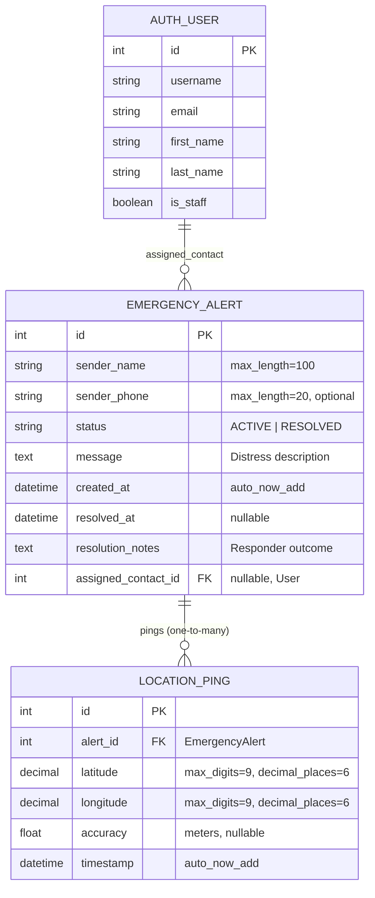

# SafeTrail: Emergency Distress & Real-Time Location Tracking System

SafeTrail is a lightweight, unified emergency distress monitoring system built with Django. It bridges the gap between individuals in distress (hikers, campus walkers, travelers) and emergency responders through a real-time web console.

The entire project runs inside a single, modular Django server with no external mobile app installations or heavy API frameworks required.

---

## 1. System Architecture (The 3-Part Flow)

1. **The Trigger (`/trigger/`)**:
   - A lightweight, mobile-optimized web page accessible from any smartphone, tablet, or laptop browser.
   - Captures device coordinates using the standard browser **HTML5 Geolocation API** (`navigator.geolocation`).
   - Includes a **"Use Demo Coordinates (India)"** feature for indoor lab testing, following a structured Indian trail route (~500m per step: straight → turn right → turn left → straight).
   - After dispatching the distress call, continuously transmits periodic location pings (**every 6 seconds in Demo Mode**, **every 10 seconds with live GPS**) to log movement.

2. **The Manager (Django Backend)**:
   - Ingests incoming SOS alerts and continuous pings via JSON endpoints (`/api/trigger-sos/` and `/api/ping-location/<id>/`).
   - Validates coordinates (`-90 <= lat <= 90`, `-180 <= lng <= 180`) and wraps alert + initial ping creation in atomic database transactions using the Django ORM.
   - Restricts dashboard and incident views to authenticated responders and emergency contacts (`@login_required`).
   - Provides live polling feeds (`/api/live-alerts/` and `/api/alerts/<id>/pings/`) and generates downloadable incident reports in CSV format.

3. **The Watcher (`/dashboard/` & `/alerts/<id>/`)**:
   - Authenticated responder console updating in real time via JavaScript `setInterval()` AJAX polling (every 3 seconds).
   - Dynamically injects new alerts into the incident table and updates the **Trail Detail** page (`/alerts/<id>/`) live without page reloads.
   - Renders live tactical pins and breadcrumb polylines on embedded **Leaflet.js** maps powered by free Esri World Street Map tiles (no API keys or watermarks required).
   - Generates one-click direct Google Maps navigation links.
   - Allows responders to resolve incidents, log notes, and inspect historical breadcrumb trails.

---

## 2. Tech Stack

- **Backend**: Python 3, Django 6.x (MVT architecture)
- **Database**: SQLite (built-in Django ORM)
- **Frontend**: Django Templates, clean utilitarian CSS, vanilla JavaScript (Fetch API)
- **Mapping**: Leaflet.js with Esri World Street Map (high resolution, free, no API keys or watermarks)
- **Device Sensors**: HTML5 Geolocation API

---

## 3. Database Design (Django ORM)

SafeTrail connects users, emergency incidents, and continuous GPS location updates using a relational model structure managed via the Django ORM:



### Model Relationships:
- **`EmergencyAlert` → `User` (Many-to-One)**: An incident can optionally be claimed or assigned to an emergency responder (`assigned_contact`). If the user account is removed, `on_delete=models.SET_NULL` preserves the incident audit history.
- **`EmergencyAlert` → `LocationPing` (One-to-Many)**: A single distress signal can receive continuous location updates over time (`related_name='pings'`). If an alert is purged, `on_delete=models.CASCADE` deletes all associated pings to maintain relational integrity.

---

## 4. Directory Layout

```text
SafeTrail/
├── .venv/                      # Python virtual environment
├── requirements.txt            # Project dependencies
├── manage.py                   # Django command-line tool
├── db.sqlite3                  # SQLite database
├── safetrail/                  # Project configuration
│   ├── settings.py
│   ├── urls.py
│   └── wsgi.py
├── beacon/                     # Core application
│   ├── models.py               # EmergencyAlert & LocationPing
│   ├── admin.py                # Django Admin with TabularInline pings
│   ├── forms.py                # AlertResolveForm ModelForm
│   ├── views.py                # Dashboard, details, CSV export & auth views
│   ├── api_views.py            # JSON endpoints for SOS ingestion & polling
│   ├── urls.py                 # App & API routing
│   └── tests.py                # Automated test suite (8 tests)
├── templates/
│   ├── base.html               # Shared layout & Leaflet resources
│   ├── beacon/
│   │   ├── trigger.html        # Mobile SOS trigger interface
│   │   ├── dashboard.html      # Watcher live console
│   │   └── alert_detail.html   # Breadcrumb movement trail view
│   └── registration/
│       ├── login.html          # Responder login
│       └── register.html       # Responder registration
└── static/
    ├── css/
    │   └── style.css           # Utilitarian, minimalist stylesheet
    └── js/
        ├── trigger.js          # GPS capture & continuous pinging
        └── dashboard.js        # 3s AJAX polling & live map markers
```

---

## 5. Getting Started

### Prerequisites
- Python 3.10+ installed on your system.

### Installation & Setup

1. **Clone or navigate into the repository**:
   ```bash
   cd SafeTrail
   ```

2. **Activate the virtual environment**:
   ```bash
   source .venv/bin/activate
   # On Windows: .venv\Scripts\activate
   ```

   *(If recreating the venv from scratch, run `python3 -m venv .venv && source .venv/bin/activate && pip install -r requirements.txt`)*

3. **Run database migrations**:
   ```bash
   python manage.py migrate
   ```

4. **Start the development server**:
   ```bash
   python manage.py runserver 0.0.0.0:8000
   ```

---

## 6. Default Credentials & Access Points

The local database comes pre-seeded with a superuser account for immediate testing:

- **Username**: `admin`
- **Password**: `admin123`

### URLs:
| Page | URL | Access | Description |
|---|---|---|---|
| **SOS Trigger** | `http://127.0.0.1:8000/trigger/` | Public | Mobile-friendly distress trigger for users |
| **Watcher Dashboard** | `http://127.0.0.1:8000/dashboard/` | Authenticated | Live monitor with AJAX polling & map |
| **Incident Details** | `http://127.0.0.1:8000/alerts/<id>/` | Authenticated | Full breadcrumb movement trail |
| **CSV Export** | `http://127.0.0.1:8000/alerts/export-csv/` | Authenticated | Instant download of incident history |
| **Django Admin** | `http://127.0.0.1:8000/admin/` | Staff/Superuser | Database inspection and user management |

### JSON API Endpoints:
| Endpoint | Method | Purpose |
|---|---|---|
| `/api/trigger-sos/` | `POST` | Creates an `EmergencyAlert` and initial `LocationPing` atomically |
| `/api/ping-location/<id>/` | `POST` | Appends a new `LocationPing` to an active alert |
| `/api/live-alerts/` | `GET` | Polling feed for the main Watcher Dashboard (every 3s) |
| `/api/alerts/<id>/pings/` | `GET` | Polling feed for the live Trail Detail map & table (every 3s) |

---

## 7. How to Demonstrate in the Lab

1. **Step 1: Open the Dashboard**:
   - Log in to `http://127.0.0.1:8000/dashboard/` using `admin` / `admin123`.
   - Observe the live tactical map and the pre-seeded incidents.

2. **Step 2: Trigger an SOS from Mobile or Another Browser Tab**:
   - Open `http://127.0.0.1:8000/trigger/` (or use your laptop's local network IP `http://<laptop-ip>:8000/trigger/` on your smartphone).
   - Enter your name, click **"Use Demo Coordinates (India)"** (or allow browser GPS), and click **"SEND EMERGENCY SOS"**.

3. **Step 3: Observe Real-Time AJAX Updates**:
   - Switch back to the dashboard tab.
   - Within 3 seconds, without refreshing, the new emergency appears at the top of the table highlighted in red, and a tactical pin drops on the map.

4. **Step 4: View Movement Trail & Resolve**:
   - Click **"Trail"** next to the incident to see the polyline connecting location updates.
   - Click **"Resolve"**, enter resolution notes, and confirm. The incident transitions to `RESOLVED`.

5. **Step 5: Export CSV**:
   - Click **"Export CSV"** in the top-right toolbar to download the incident report spreadsheet.

---

## 8. Running Automated Tests

Run the full automated test suite covering API ingestion, coordinate validation, live polling, permissions, and CSV export:

```bash
python manage.py test beacon
```

